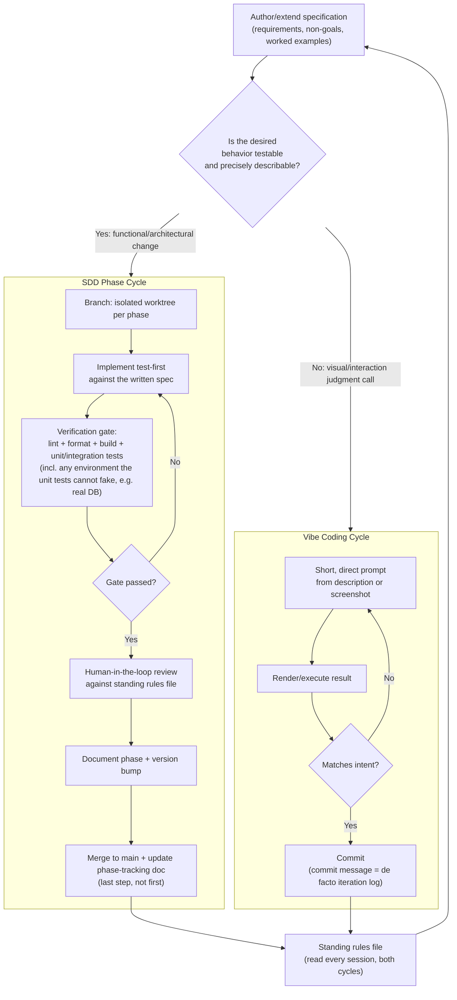

# An Experience Report on a Specification-Driven, AI-Assisted Software Construction Project

## Team Details (Team — ResearchPilot)

| Student Name | Student ID | Role in the project | Contribution (%) |
| --- | --- | --- | --- |
| Marcus Gustafsson | [Insert Student ID] | Specifier, Prompt Engineer, Verifier (solo team) | 100% |

This is a one-person team. Every role the template lists for a multi-person team —
writing specifications, prompting the coding agent, auditing its output, running
verification — was carried out by the same person, in sequence, on every phase of the
project. Section 6.2 discusses how that single role rotated rather than how it was
split across people.

---

## Executive Summary

ResearchPilot is a web application that turns a research question into an organized
literature map: it retrieves real scholarly papers from the OpenAlex API, deduplicates
and ranks them, embeds and clusters them into subtopics, and uses an LLM to name each
cluster and explain why a given paper belongs in it, all editable by the user. The
backend is Python 3.12+/FastAPI/SQLAlchemy over PostgreSQL; the frontend is same-origin
vanilla JavaScript. It was built solo, over fourteen planned phases, using
**Specification-Driven Development (SDD)** as the primary methodology and **vibe
coding** for a minority of presentation-only iterations.

The specification technique was semi-formal: a single Markdown Software Requirements
Specification (`docs/requirements.md`, 39 numbered sections covering user flow, pipeline
stages, domain model, API surface, and explicit non-goals), a component diagram
(`docs/architecture.md`), an entity list (`docs/data-model.md`), a phase-to-deliverable
roadmap (`docs/roadmap.md`), and a persistent agent rules file (`AGENTS.md`) that
encodes architectural invariants (e.g. "LLMs must never generate authoritative paper
metadata") the coding agent must respect in every session. No GitHub Spec-Kit
installation was used; the same discipline — specification as the source of truth,
consumed directly by the agent — was achieved with plain Markdown and a rules file,
which Section 4.1 explains further.

The AI tooling was **Claude Code** (Anthropic) as the sole coding agent throughout
construction, and, inside the shipped product itself, the **OpenAI API** (an embeddings
model and `gpt-4o-mini`) for query expansion, cluster naming, and paper-classification
explanations — never for scholarly facts. The SDD workflow was phase-based: each phase
was branched into its own git worktree, implemented test-first, verified against a
fixed gate (lint, format, a syntax check on the frontend, a build, and two pytest
suites — one fast in-memory suite and one against real PostgreSQL exercising
migrations and concurrency), documented in a `docs/phase-N.md`, versioned, and
fast-forward merged into `main`. Verification and validation combined this
automated gate with human-in-the-loop code review against `AGENTS.md`'s invariants;
Section 5 documents a concrete AI-introduced bug this caught and fixed.

---

## 1. Introduction & Paradigm Shift

### 1.1 Project Overview & Objectives

Literature review is slow because a researcher must manually search several databases,
judge relevance, and mentally cluster papers into subtopics before any reading happens.
ResearchPilot automates the mechanical part of that process while keeping the
researcher in control of the result. A user creates a project with a research
question, optional keywords, a year range, and a paper limit; the system then:

1. asks an LLM to propose up to five additional scholarly search queries grounded in
   the question (the original question is always searched regardless);
2. queries OpenAlex for each query and normalizes the results into a common `Paper`
   shape;
3. deduplicates by DOI, then external identifier, then normalized title;
4. scores lexical relevance and drops anything under a fixed 0.10 threshold;
5. embeds title+abstract and clusters the survivors deterministically (k-means);
6. asks an LLM to name and describe each cluster from the papers actually in it;
7. renders the result as a research map the user can browse, filter, and edit
   (rename/move/merge/split subtopics, mark papers irrelevant), with on-demand,
   cached explanations of why a paper was placed where it was.

The guiding objective, stated explicitly in `docs/requirements.md` §39 and enforced
throughout, is a strict separation of concerns: **deterministic systems own facts and
retrieval; AI owns interpretation; the user has final control.** No citation, author,
DOI, or date shown to the user is ever generated by an LLM — only scholarly-provider
data reaches those fields.

### 1.2 The Vibe Coding

"Vibe coding" here means directing the coding agent conversationally, from a screenshot
or a one-line description of desired behavior, without first writing a section of the
specification for it — trusting the agent's judgment and iterating on the rendered
result rather than on a written contract. This project used vibe coding narrowly, for
CSS/interaction polish where writing a formal spec would have cost more than trying
something and reacting to how it looked. A representative example is the cluster-tab
UI: Phase 4 shipped with a plain dropdown selector, then went through four short,
purely reactive iterations in immediate succession (`6022e3e` → `76c8f7b` → `4f4d23c` →
`dd5521f`): render clusters as collapsible sections, switch to a tab bar, turn the tabs
into filter pills with no default selection, then give inactive pills an outline
instead of a fill. Each step was a reaction to how the previous one actually rendered
in the browser, not to a written requirement — the definition of vibe coding as used
here. A second, shorter chain did the same for the open-access pill after Phase 9
(`c3de6f0` → `9848efa` → `e0e5eca`). Section 3 documents both in more depth, and the
full log of every prompt used across the project — SDD and vibe coding alike — is kept
in [`docs/prompts.md`](prompts.md).

### 1.3 The SDD Methodology

Specification-Driven Development inverts the vibe-coding relationship: a written
specification is authored and reviewed *before* the agent writes code, the agent is
instructed to implement against that specification rather than its own judgment, and
the specification — not the resulting code — is the artifact of record when questions
arise later. This project used SDD for everything with functional or architectural
weight: the pipeline stages, the domain model, the API, persistence, and every
correctness-sensitive edit path (concurrency locks, cache invalidation, filter
semantics).

The toolkit was **Claude Code driven directly off a set of plain-Markdown
specifications**, not GitHub's Spec-Kit CLI (`/specify`, `/plan`, `/tasks`). This was a
deliberate choice, explained in Section 4.1. The specification is
`docs/requirements.md` — an SRS-style document with a product overview, an explicit
non-goals list, a suggested-but-not-mandated domain model, and worked examples for
almost every feature — plus `docs/roadmap.md`, which maps each of the 39 requirement
sections onto one of 14 build phases in dependency order (a scholarly provider before
clustering before an LLM naming step before a UI to show it, etc.). `AGENTS.md` sits
above both as a standing "constitution": architectural rules (`LLMs must never generate
authoritative paper metadata`, `Business logic must not directly depend on OpenAI or
OpenAlex`, `User edits override AI-generated categorization`) that apply to every phase
and are re-read by the agent every session, regardless of which phase is active.

The development timeline ran phase-by-phase rather than by calendar date: Phases 1–9
(project CRUD and persistence through open-access status and links) were implemented,
verified, and merged to `main` first, delivering the MVP's acceptance-scenario spine.
Phases 10, 11, and 13 (structured query expansion, deterministic relevance filtering,
and on-demand classification explanations) followed as stabilization work refining
that same spine — at the time of writing they are implemented and locally verified
(Section 5.3) but not yet carried through the full merge-and-version-bump ritual
described in Section 6, which Section 7.2 discusses as a concrete process bottleneck.
The workflow for both Vibe Coding and SDD phases is diagrammed in Section 7.4, which
proposes it as a reusable process.

---

## 2. Requirements & System Specification

### 2.1 Stakeholders

- **The researcher / end user** — the only user role in the MVP. Chosen because the
  product's entire value proposition (faster, organized literature discovery) is
  realized at the point of a single person running a search and reading the result;
  there is no reviewer, admin, or approval workflow to model yet.
- **The institution/library (future)** — not implemented, but named explicitly in
  `docs/requirements.md` §18 as a stakeholder whose eventual need (SSO-gated full-text
  access) must not be architecturally foreclosed. Chosen so the `PaperProvider` and
  access-status abstractions were designed with an `INSTITUTIONAL_ACCESS` slot from
  the start rather than bolted on later.
- **The scholarly data provider (OpenAlex, and any future provider)** — treated as a
  stakeholder because its data-quality and rate-limit behavior directly bounds what
  the product can promise (e.g. "may add up to five related queries," "at least
  several dozen papers," graceful handling of provider failure). Modeling it as a
  stakeholder rather than an implementation detail is why `PaperProvider` is an
  interface with one current implementation, not a concrete OpenAlex client called
  from business logic.
- **The course grader** — an indirect but real stakeholder for this specific
  deliverable: the report and git history exist to make the SDD process legible to a
  third party, not only to make the software work.

### 2.2 Functional Requirements

Functional requirements describe *what the system must let a user do*, independent of
how it is built. This project's functional requirements, from `docs/requirements.md`
§§2–17, are:

- Create, view, and persist a research project (question, keywords, year range, paper
  limit).
- Retrieve papers from a real scholarly API and normalize them to a common shape —
  never invent citations.
- Deduplicate papers by DOI → external identifier → normalized title.
- Expand the user's question into up to five additional grounded search queries,
  shown and individually enabled/disabled by the user.
- Score and filter papers by relevance before clustering.
- Cluster relevant papers by embedding similarity and give each cluster an
  AI-generated name, description, and keyword list grounded only in its own papers.
- Explain, per paper, why it was placed in its subtopic, using only that paper's
  metadata.
- Let the user rename, merge, split, or delete a subtopic; move a paper between
  subtopics; mark a paper irrelevant — and never have those edits silently
  overwritten by a later automatic search.
- Show each paper's open-access status and a link to full text or the publisher page
  when available.
- Show search transparency: which queries ran, how many papers were found/deduplicated
  /filtered, and staged progress while a search is running.

### 2.3 Non-Functional Requirements

Non-functional requirements describe *quality attributes* the system must have
regardless of feature set. This project's, from `docs/requirements.md` §31, are:

- **Performance:** support at least 100–250 papers in a project without noticeable UI
  slowdown; stage deadlines (60s retrieval, 60s embedding, 30s per-cluster naming,
  a 240s search lease) bound worst-case latency rather than letting one slow
  provider call hang the whole pipeline indefinitely.
- **Reliability:** a single provider failure (OpenAlex, OpenAI, embeddings) must
  degrade gracefully — e.g. query expansion falls back to the original question,
  cluster naming falls back to numeric labels — rather than failing the entire
  search.
- **Maintainability:** scholarly providers, LLM providers, embedding providers, and
  the clustering algorithm must be swappable behind interfaces without touching
  business logic.
- **Security:** API keys live only in server-side environment variables and are
  never exposed to the frontend.
- **Explainability:** a user must always be able to see where a paper came from, why
  it was scored relevant, and why it landed in its subtopic.
- **Reproducibility:** enough is persisted per search (queries used, filters, provider,
  timestamp) to reconstruct how a given result was produced.

### 2.4 Technology Stack

| Layer | Choice | Reason |
| --- | --- | --- |
| Backend | Python 3.12+, FastAPI, SQLAlchemy | Fast to iterate on with an AI coding agent; FastAPI's typed request/response models pair naturally with structured LLM output and give free OpenAPI docs (`/docs`) as a spec-checking tool in themselves. |
| Database | PostgreSQL | Requirements explicitly recommend a relational database (§24); Postgres row locking is used for real concurrent-search safety, verified in a dedicated integration suite. |
| Scholarly data | OpenAlex | Free, no-auth-required, broad coverage; the requirements name it as the recommended first provider (§5). |
| Embeddings + LLM | OpenAI (embeddings model + `gpt-4o-mini`) | Structured-output support (JSON mode) matches the "validate before storing, never parse arbitrary prose" rule in §21; low-cost model is sufficient because the model only names/explains clusters, never asserts facts. |
| Frontend | Same-origin vanilla JavaScript | No build step, no framework churn to keep in sync with a fast-moving backend spec; appropriate for a single-page research map with no complex client state. |
| **AI generation & orchestration tools** | **Claude Code (Anthropic)** for all construction; OpenAI API consumed *by the product* at runtime | See Section 4.1 for why Claude Code was driven directly from Markdown specs rather than through GitHub Spec-Kit. |

### 2.5 Interface & API Specifications

The API is REST-ish JSON over HTTP, documented in `docs/requirements.md` §26 and
realized (with additions made during implementation) as:

```
GET/POST   /api/projects
GET/PUT/DELETE /api/projects/{id}
POST       /api/projects/{id}/search            (?force=true to confirm replacing edits)
GET        /api/projects/{id}/searches           (latest 20 attempts + progress)
GET        /api/projects/{id}/papers
GET        /api/projects/{id}/subtopics
GET/POST   /api/projects/{id}/queries
PATCH      /api/projects/{id}/queries/{queryId}?enabled=true|false
PATCH      /api/projects/{id}/papers/{paperId}          ({clusterId, isRelevant})
PATCH/POST/DELETE /api/projects/{id}/subtopics[/{clusterId}]
POST       /api/projects/{id}/subtopics/{clusterId}/merge
POST       /api/projects/{id}/papers/{paperId}/explanation
```

Errors are uniform: `422` invalid input, `404` missing resource, `409` conflict (e.g.
editing during an active search), `503` database failure. Full request/response
schemas are generated from the FastAPI models and served at `/docs`, so the
"specification" for this layer is partly executable rather than purely descriptive.

### 2.6 How These Requirements and Specifications Were Created

`docs/requirements.md` was authored directly as a Markdown document — not generated by
prompting an AI tool from a blank page — because the product idea and its constraints
(don't let the LLM invent citations; keep providers swappable) were already clear
before any tool was involved. What the AI tool (Claude Code) *was* used for at the
specification stage was decomposition: given the finished requirements document, it was
asked to propose a phase order that respected dependencies (a provider before
clustering, clustering before naming, naming before a UI that shows names), producing
`docs/roadmap.md`. Each phase's own scope was then re-derived from the relevant
requirement sections at the start of that phase's session, rather than trusting memory
of an entire 39-section document across many separate sessions — the point of keeping
the specification in the repository instead of only in a chat transcript.

---

## 3. Vibe Coding and Your Project

Vibe coding was scoped deliberately narrowly: to changes where the "correct" outcome is
a visual/interaction judgment call rather than a testable behavior, and where writing a
specification section first would take longer than just looking at the result. It was
not used for anything in the pipeline, domain model, or API — those went through SDD
(Section 4) because getting them wrong silently produces wrong literature maps, not
just an ugly page. As a solo project there was no module-division-among-teammates
decision to make; the "division" that did exist was temporal: SDD for anything with a
written requirement behind it, vibe coding for anything that only existed as "make this
look right."

### 3.1 Prompting Framework

The prompting style for vibe coding was direct, single-turn, and screenshot- or
description-driven — closer to "here's what's on screen, change X" than a
chain-of-thought or multi-step agentic framework. No custom promptbook or agentic
pipeline was built for this category of work; each request was self-contained and
evaluated immediately by re-rendering the page, which is why iteration happened as a
sequence of small commits rather than as one long back-and-forth inside a single
prompt.

### 3.2 Master Prompts / System Prompts

There is no single master/system prompt for vibe coding in this project — each
interaction was a short, ad hoc instruction. `AGENTS.md` plays the closest thing to a
"system prompt" role: it is read automatically at the start of every Claude Code
session (vibe-coding or SDD) and encodes standing rules ("Follow existing project
structure," "Prefer simple implementations over premature abstractions," "Do not
commit secrets," "Run tests before considering a task complete") that constrain *how*
any instruction — however casual — gets implemented. The prompts below are
representative of the actual vibe-coding sequence, reconstructed from the commit
history rather than pasted from a saved transcript, since no per-session transcript
was archived for this stretch of work:

Phase 4's SDD implementation shipped a plain `<select>` dropdown as the cluster
selector — a reasonable but minimal reading of "one tab per cluster" with no visual
spec attached. Four vibe-coding rounds followed, each reacting to how the previous one
actually looked and behaved in the browser:

1. *"Render each cluster as a collapsible section instead of a dropdown."*
   **Expected:** a clearer view of one cluster's papers at a time. **Actual:**
   functionally workable, but with every cluster's section on the page at once, long
   result sets made the page unwieldy to scroll.
2. *"Switch the cluster view to a tab bar instead."* **Expected:** only one cluster's
   papers visible at a time, with cheap switching. **Actual:** correct, but the tabs
   defaulted to the first cluster selected, so a user landed on an arbitrary subset
   instead of seeing everything retrieved.
3. *"Make the cluster tabs act as filter pills, with none selected by default."*
   **Expected:** an "all papers" default with optional filtering. **Actual:** correct
   behavior, but inactive pills used a filled style visually indistinguishable from
   active ones, so it wasn't obvious anything was filterable at all.
4. *"Give inactive cluster tabs an outline instead of a fill."* **Expected and
   actual:** the two states became visually distinct; this iteration matched
   expectations and closed the sequence.

The same pattern recurred, more briefly, after Phase 9 added the open-access pill:
*"Keep the open-access filter label constant"* (it was relabeling itself based on
filter state, which read as a bug rather than a feature) → *"Move the paper filters
into the panel heading and tidy the cluster pills"* (layout felt cluttered once the
open-access filter sat next to the existing set-aside toggle) → *"Pin the paper access
pill to the card's top-right"* (its position shifted with title length, which looked
unintentional). The complete, unabridged prompt log for both chains and every SDD
phase — including purpose and reasoning for each entry, not just the headline text —
is kept in [`docs/prompts.md`](prompts.md) rather than reproduced in full here.

### 3.3 Prompt Iteration Log

| Initial Prompt/Specification | AI Failure Mode / Bug Produced | Refined Prompt/Specification | Resulting Code Quality | What did not happen according to plan | Modified Prompt |
| --- | --- | --- | --- | --- | --- |
| "Render each cluster as a collapsible section instead of a dropdown." | Correct component swap, but wrong information architecture: every cluster's section rendered on the page at once, so nothing was actually filtered — long result sets became unwieldy to scroll. | "Switch the cluster view to a tab bar instead," followed by "Make the cluster tabs act as filter pills, with none selected by default." | Tabs became true filters with an explicit "show all" default state. | "Collapsible section" was read as "always-visible section," not "one-at-a-time disclosure" — the instruction didn't specify mutual exclusivity. | Two follow-up prompts, each correcting one remaining ambiguity, rather than one large rewritten prompt. |

Per `docs/local-dev-environment` notes kept during the project, this single UI
decision took roughly five round trips end-to-end, and several of those were spent
re-checking a change that had actually already landed but was masked by the browser
caching the previous CSS — a process failure (verification method), not a prompt or
specification failure. That distinction — is a bad result the agent's fault, the
prompt's fault, or the verification loop's fault? — is exactly the kind of judgment
Section 7.2 returns to.

---

## 4. Specification Driven Development and Your Project

### 4.1 SDD Tool-kit

GitHub's Spec-Kit was considered and deliberately not adopted. Spec-Kit's value is a
standardized slash-command scaffold (`/specify`, `/plan`, `/tasks`) that structures
specification authoring for teams who don't already have a convention. As a solo
developer, that scaffold would have added a layer of indirection over what was already
being done directly: writing the specification as a plain Markdown document, keeping it
in the repository next to the code it governs, and pointing the coding agent at it
explicitly. The toolkit actually used was:

- **`docs/requirements.md`** as the SRS — the source of truth Spec-Kit's `/specify`
  step would otherwise produce.
- **`docs/roadmap.md`** as the phase plan — the analog of Spec-Kit's `/plan`.
- **`AGENTS.md`** as a persistent, cross-phase constitution of architectural rules,
  read by the agent every session regardless of which phase is active — something
  Spec-Kit does not provide by default.
- **Claude Code** as the coding agent, given the requirements/roadmap/rules files as
  context and instructed, per phase, to implement one phase's scope only.

The reason to choose this over Spec-Kit was cost versus benefit at team size one:
Spec-Kit's structure pays for itself when it keeps several people's specifications
consistent; with one person authoring and consuming every document, the same
discipline (spec as source of truth, checked into git, read by the agent before code is
written) was achievable with less ceremony.

### 4.2 Development Environment

Claude Code (Anthropic) was used as the IDE-agnostic coding agent, invoked from a
terminal against a local checkout, because it can read and write the repository
directly (specs, code, migrations, tests) rather than operating through a chat window
disconnected from the filesystem, and because it reads `AGENTS.md` automatically at
session start — no separate prompt had to restate the project's standing rules every
time. Postgres ran locally via Docker Compose (`compose.yaml`); because the
development shell lacked passwordless Docker/sudo access, starting and stopping the
database was a manual, human-in-the-loop step even though everything else — writing
code, running the SQLite test suite, running lint/format — was agent-driven. That
split is itself a small but real instance of the human-oversight point Section 7.3
returns to: infrastructure lifecycle stayed a human responsibility while application
construction did not.

### 4.3 Deriving the Requirements Using the IDE/Coding Agents

The initial SRS was authored directly rather than derived by prompting an agent from
nothing (Section 2.6). Where the coding agent *did* participate in requirements-adjacent
work was:

- **Specifying system constraints per phase:** at the start of each phase, the agent
  was asked to restate, in its own words, which requirement sections and roadmap phase
  it was about to implement, before writing code — a cheap check that catches scope
  drift (implementing part of a later phase, or missing a constraint) before it is
  expensive to undo.
- **Defining interfaces:** `PaperProvider`, `LlmProvider`, `EmbeddingProvider` were
  specified in `docs/requirements.md` as *suggested* abstractions ("Create an
  abstraction such as...") and then concretely designed collaboratively with the
  agent during the corresponding phase, since the exact method signatures were an
  implementation decision, not a requirement.
- **Establishing acceptance criteria:** `docs/roadmap.md`'s "MVP Definition of Done"
  (18 numbered end-to-end scenario steps) was used verbatim as the phase-9 acceptance
  check before declaring the MVP spine complete.
- **Establishing compliance requirements:** the hallucination-protection rule
  (§22 — LLMs must never be an authoritative source for titles, authors, DOIs,
  dates, journals, citation counts, or URLs) functions as this project's compliance
  requirement, and was promoted into `AGENTS.md` as a standing rule precisely because
  it must hold across every phase, not just the phase that first implemented it.

### 4.4 SDD Workflow and Implementation

The workflow actually used, applied to every phase from 1 through the current one, was:

1. **Branch:** create a dedicated git worktree at `../ResearchPilot-phaseN` on branch
   `phase-N`, from `main`.
2. **Implement test-first:** write or extend `test_*.py` alongside the implementation
   for every module touched.
3. **Verify against a fixed gate before merging:**
   `ruff check .`, `ruff format --check .`, `node --check frontend/app.js`, `uv build`,
   `uv run pytest` (fast, SQLite), and the same suite again against a real disposable
   PostgreSQL database (exercising actual migrations and the concurrency-sensitive
   paths the SQLite run skips).
4. **Document:** add `docs/phase-N.md` (Boundaries / feature sections / Storage /
   Deliberate omissions / References) and update the README's description of current
   behavior.
5. **Version:** bump `pyproject.toml` to `0.N.0` and the `ResearchPilot/0.N` User-Agent
   string sent to external APIs, and add one additive, numbered SQL migration per
   schema change (temporary `DEFAULT` then `DROP DEFAULT` when backfilling existing
   rows).
6. **Integrate:** `git merge --ff-only phase-N` into `main`, then push both `main` and
   the phase branch.

This is a linear, gated pipeline by design: nothing merges to `main` that hasn't passed
every check in step 3, which is what makes `main` always deployable and always a valid
base for the next phase's worktree.

### 4.5 Prompts

Representative SDD prompts, reconstructed from the commit and phase-doc record rather
than a saved transcript (per the same caveat as Section 3.2):

- *"Implement Phase 4 per `docs/requirements.md` §9 and `docs/roadmap.md`: embed
  paper title+abstract, cluster deterministically, and make the clustering algorithm
  replaceable."* **Expected:** an `EmbeddingProvider` interface, a k-means (or
  similar) clustering service, and tests covering both in isolation from the OpenAI
  network call. **Actual:** met expectations on the first pass — the requirement was
  specific enough (embedding → vector → clustering algorithm → clusters, §9's own
  pipeline diagram) that there was little room for a plausible-but-wrong
  interpretation, unlike the vibe-coding "tab bar" example in Section 3.3.
- *"Add Phase 9: compute `Paper.accessStatus` from `isOpenAccess`, `openAccessUrl`,
  and `abstract` as `OPEN_ACCESS` / `ABSTRACT_ONLY` / `UNKNOWN`, `INSTITUTIONAL_ACCESS`
  reserved and never emitted; no new resolver, no migration — OpenAlex already
  aggregates Unpaywall data."* **Expected:** a computed, read-only field with no
  schema change. **Actual:** the field was correctly computed, but as a Pydantic
  `@computed_field` it was *also* present in `model_dump()`, which the paper-persistence
  code fed directly into building the SQL insert for `replace_papers` — since
  `access_status` is not a real `PaperRow` column, this was a latent insert-time bug.
  See Section 5.2 for how it was caught and fixed; it is one of this project's clearer
  examples of a correctness bug introduced by an otherwise-correct implementation of an
  otherwise-correct specification, which is why Section 5 treats verification as a
  separate concern from writing a good specification in the first place.

These two are representative; the original prompt, purpose, and reasoning for all
thirteen SDD phases — including Phases 2, 3, and 8, whose specifications needed a
genuine refinement round, not just Phase 4 and 9's headline examples — are recorded
in full in [`docs/prompts.md`](prompts.md).

---

## 5. Verification and Validation

### 5.1 V&V Strategy

Verification combined automated and human-in-the-loop methods rather than relying on
either alone:

- **Test-Driven Development:** every module has a corresponding `test_*.py`, written
  alongside (in practice, usually just ahead of) the implementation it covers, so a
  phase is not considered implemented until its own tests pass — not written
  retroactively against whatever the agent happened to produce.
- **Unit and integration testing:** the fast suite (`uv run pytest`, SQLite) covers
  domain logic, deduplication/ranking, clustering, and API behavior in isolation from
  external services, using fake `PaperProvider`/`EmbeddingProvider`/`LlmProvider`
  implementations (`RecordingProvider`, `RecordingEmbeddingProvider`,
  `RecordingLlmProvider`) so no test depends on a paid API call. A second run of the
  same suite against a real, disposable PostgreSQL database exercises actual
  migrations and Postgres-specific row-locking behavior the SQLite run cannot (see
  the two `SKIPPED` rows in Section 5.3).
- **Functional/UI testing:** `backend/tests/test_browser.py` drives a real Chromium
  instance via Playwright against the real FastAPI app (with the same deterministic
  fake providers), verifying that the research map actually renders and behaves as
  specified end to end, not just that the API returns the right JSON.
- **Requirement verification:** `docs/roadmap.md`'s 18-step MVP Definition of Done was
  used as an explicit acceptance checklist, not left implicit.
- **Human-in-the-loop review:** every phase's diff was read against `AGENTS.md`'s
  architectural rules before merging — the mechanism that caught the bug in
  Section 5.2, which no automated test happened to cover at the time.
- **Compliance testing:** the hallucination-protection rule (§22) was checked by
  inspection of every LLM-facing prompt in `prompts.py` (Section 2.5) to confirm each
  one only ever asks the model to interpret data already supplied, never to assert a
  fact.

**Threats to validity:** the fake-provider test strategy means the *shape* and
*failure modes* of OpenAlex/OpenAI responses are tested, but not their real-world
content or rate-limit behavior — a live-provider smoke test (documented informally,
not automated) was run once per phase that touched a provider, e.g. Phase 4 confirmed
against a real 100-paper/3-cluster search, but this is not part of CI and is not
repeatable evidence of correctness on its own.

### 5.2 Code Audit Log

- **Issue found:** the Phase 9 `Paper.accessStatus` computed field leaked into
  `model_dump()`, which `replace_papers` fed into building a SQL insert — the insert
  would have referenced a non-existent `PaperRow` column at the moment the code path
  ran, since `accessStatus` is derived, not persisted.
  **Resolution:** human-in-the-loop review against `AGENTS.md`'s architecture rules
  caught the mismatch; `replace_papers` was changed to filter `model_dump()` down to
  real `PaperRow` columns before building the insert, and this was recorded in the
  phase-9 development notes explicitly so the same class of bug (a new computed field
  silently reaching a persistence path) is checked for on any future computed field.
- **Issue found:** an unconstrained coding agent will, left to its own judgment,
  reach for the path of least resistance — e.g. calling the OpenAI client directly
  from a route handler, or letting the LLM's response stand in for a paper fact when
  a required field is missing. Neither of these appeared as a shipped bug, because
  `AGENTS.md`'s rules ("Business logic must not directly depend on OpenAI or
  OpenAlex," "LLMs must never generate authoritative paper metadata") were enforced
  as review criteria on every phase, not only the phases that first introduced the
  `PaperProvider`/`LlmProvider` interfaces.
  **Resolution:** structural — the interfaces exist specifically so this class of
  violation is visible at review time as "this import shouldn't be here," rather than
  needing a runtime check.
- **Issue found:** concurrent access — an automatic search running at the same time as
  a manual edit (rename/move/merge) could otherwise silently overwrite the user's
  edit or leave inconsistent state. This is a logical-flaw class, not a security flaw.
  **Resolution:** a search lease plus row locking makes edits during an active search
  return `409` instead of racing; a real-PostgreSQL-only concurrency test
  (`test_search.py:653`, `:862`) verifies the row-locking path directly, which is why
  those two tests are marked `SKIPPED` rather than passing when only SQLite is
  available (Section 5.3) — the fast suite cannot exercise Postgres-specific locking
  at all, so skipping is more honest than a false pass.

### 5.3 Test Execution Results

All results below are from a live run against this repository on 2026-09-17, not
historical figures:

| Check | Command | Result |
| --- | --- | --- |
| Fast test suite | `uv run pytest` | **180 passed, 2 skipped**, in 11.4s |
| Skipped tests | — | Both require real PostgreSQL row locking (`test_search.py:653`, `:862`); correctly skipped, not failing, when only SQLite is configured |
| Lint | `uv run ruff check .` | All checks passed |
| Formatting | `uv run ruff format --check .` | 44 files already formatted |
| Frontend syntax | `node --check frontend/app.js` | OK |
| Package build | `uv build` | Successfully built `researchpilot-0.9.0` (sdist + wheel) |
| CI (`.github/workflows/checks.yml`) | GitHub Actions, on every push/PR | Runs the same suite twice (once against a real Postgres 17 service container) plus lint, format, frontend check, and build |

Test distribution: 116 test functions across 8 files (`test_analysis.py` 12,
`test_clustering.py` 9, `test_openai.py` 20, `test_openalex.py` 14, `test_papers.py` 2,
`test_projects.py` 8, `test_browser.py` 3, `test_search.py` 48 — the largest file,
reflecting that the search/edit/concurrency pipeline is where correctness matters most
and where the requirements are most detailed). No coverage percentage is collected
(no `pytest-cov` configured); breadth is instead argued by requirement-to-test mapping
in each `docs/phase-N.md`. No defects are open at the time of writing beyond the
process gap in Section 7.2 (phases implemented and locally verified but not yet
through the version-bump/merge ritual) — a project-management gap, not a code defect.

---

## 6. Project Management & AI Toolchain Workflows

### 6.1 Version Control & Prompt Integration

Commit messages link directly to specification units rather than describing code
mechanically: every phase's integrating commit is titled `Implement Phase N
<feature>` (e.g. `Implement Phase 8 manual organization`), which is traceable to both
`docs/roadmap.md`'s row for that phase and the corresponding `docs/phase-N.md`. Smaller
follow-up commits (e.g. `Keep the open-access filter label constant`,
`Move paper filters into the panel heading; tidy cluster pills`) describe the concrete
behavior changed rather than "fix bug" — each is small enough to correspond to roughly
one vibe-coding round from Section 3.3. Prompt iterations themselves are not committed
as separate artifacts; the commit sequence *is* the iteration log for UI work, since
each commit represents one accepted response to one prompt.

**Workspace configuration:** the entire "workspace setup" is `AGENTS.md` (persistent
rules, read every session) plus the `docs/` specification set (read at the start of
whichever phase is active) plus a fixed local toolchain (`uv`, `ruff`, `pytest`,
Docker Compose for Postgres). Issues were handled by writing them into the relevant
document rather than as inline chat instructions repeated every session — e.g. the
"no `psql` binary; use a Python/SQLAlchemy snippet" and "shell user can't start Docker,
ask a human" constraints were recorded as standing environment notes precisely so
they would not need to be rediscovered in a later session.

### 6.2 Team Contribution Breakdown

As a one-person team, the shift the template describes — from "coding" to
"specifying, prompting, auditing, and orchestrating" — happened sequentially within
one person rather than being split across teammates:

- **As Specifier:** authored `docs/requirements.md`, `docs/architecture.md`,
  `docs/data-model.md`, and `AGENTS.md` before any implementation began, and extended
  `docs/roadmap.md` as later phases (10, 11, 13) were identified.
- **As Prompt Engineer:** issued the per-phase SDD prompts (Section 4.5) and the
  looser vibe-coding prompts (Section 3.2), and decided, per task, which mode was
  appropriate.
- **As Verifier/Orchestrator:** ran the phase gate (Section 4.4) before every merge,
  performed the `AGENTS.md`-rule-based review that caught the bug in Section 5.2, and
  managed the git worktree/branch/merge lifecycle itself.

The practical effect of solo ownership was that there was no handoff latency between
these roles — a bug found during audit could be fixed by immediately re-prompting,
rather than filed for someone else — but also no second reviewer, which Section 7.2
returns to as a limitation rather than an unambiguous advantage.

---

## 7. Reflections on Specification-Driven Development

### 7.1 Benefits of AI-Assisted SDD

The clearest win was construction speed on well-specified, mechanically-shaped work:
Phase 1 (project CRUD + PostgreSQL foundation) and Phase 2 (OpenAlex retrieval +
normalization) each landed in a single phase cycle with no rework, because
`docs/requirements.md` already specified the exact shape of the data
(§5's `Paper` field list) and the exact behavior (§3's example inputs/outputs) —
there was nothing left for the agent to guess. Compared to manually typing the
equivalent SQLAlchemy models, Pydantic schemas, FastAPI routes, and their tests, this
was a large, unambiguous speedup, and the speedup scaled with how precisely the
requirement had been written — precisely the opposite of what happens with an
under-specified prompt, discussed next.

### 7.2 Core Bottlenecks and Challenges

The paradigm struggled in two places, both visible in this repository's own history:

- **Ambiguity, not context-window limits, was the real bottleneck.** The five-round
  cluster-tab iteration (Section 3.3) was not caused by the agent forgetting context
  or hallucinating a package — it was caused by "tab bar" being a genuinely ambiguous
  instruction with several equally plausible implementations, only one of which was
  intended. SDD's answer to this — write down the intended behavior first — is also
  its cost: it would have taken longer to *specify* "filter pills with no default
  selection, single navigation metaphor" up front than it took to iterate visually
  five times. This is why vibe coding was kept, deliberately, for exactly this class
  of decision, rather than treated as a shortcut to be eliminated.
- **Process drift between "implemented" and "the ritual that stamps it as done."**
  `docs/roadmap.md` lists Phase 12 as delivered and reflects Phases 10, 11, and 13 in
  its table, but at the time of writing `pyproject.toml` is still at `0.9.0`, there is
  no `docs/phase-12.md`, and Phases 10/11/13 sit as uncommitted working-tree changes
  rather than merged, version-bumped commits. This is a real instance of the
  specification document (the roadmap) getting ahead of the process that is supposed
  to certify a phase as finished — the opposite failure mode from "AI drifting from
  the spec": here, the *tracking document* drifted ahead of the *implementation
  ritual*. The fix is procedural, not a smarter prompt: treat "update the roadmap
  table" as the *last* step of the phase-4.4 workflow, not something that can happen
  early.
- **No hallucinated package dependencies were encountered** in this project, likely
  because the dependency list (`pyproject.toml`) is small, explicit, and reviewed on
  every phase's diff rather than left to accumulate silently.

### 7.3 Lessons Learned & Best Practices

- **A precise specification is worth more than a clever prompt.** Every case where
  the agent's output matched intent on the first try (Phase 4's clustering
  abstraction, Phase 9's access-status enum) traces back to `docs/requirements.md`
  already containing a worked example or an explicit field list. Every case that
  needed rework (the cluster-tab UI) traces back to an instruction with no written
  specification behind it at all.
- **Vibe coding and SDD are not competitors; they are suited to different kinds of
  ambiguity.** SDD wins when the "right answer" is a testable behavior (a computed
  field, a filter threshold, a locking rule) — writing it down once is cheaper than
  any number of iterations. Vibe coding wins when the "right answer" is a visual or
  interaction judgment call that is genuinely faster to evaluate by looking at it than
  by describing it in words — and evidence for this project is that trying to force
  the tab-bar decision into a written spec first would plausibly have cost more total
  time than the five rounds it actually took.
- **A persistent rules file (`AGENTS.md`) is what makes solo AI-assisted SDD safe
  across many sessions.** Without it, invariants like "the LLM never supplies paper
  facts" would need to be re-stated by the human every session or rediscovered by
  inspecting old code — exactly the kind of silent regression risk a one-person team
  with no second reviewer cannot afford. Concretely, this is what let the Phase 9
  `model_dump()` bug (Section 5.2) get caught during ordinary review rather than
  needing a dedicated test that happened to be written for that exact case.
- **Verification methods must be chosen to match what a test *cannot* fake its way
  past.** The decision to run the same suite twice — once against SQLite, once against
  real PostgreSQL — exists because the concurrency bug class in Section 5.2 is
  specifically a Postgres row-locking behavior that an in-memory SQLite database
  cannot exhibit at all; a suite that only ever ran against SQLite would have reported
  green while shipping a real race condition.
- **Best practice for future students:** keep the specification, the phase plan, and
  the standing rules file as three separate documents with three separate lifecycles
  (rewritten occasionally, extended per phase, and read every session, respectively) —
  collapsing them into one file makes it hard to tell "policy that always applies"
  from "this phase's particular scope."

### 7.4 Proposed Specification-Driven Development Workflow

Based on this project's experience, the workflow below generalizes the phase cycle in
Section 4.4 and the lesson in 7.3 that ambiguity — not scale — is SDD's real cost
driver, by routing each unit of work to whichever mode (SDD or vibe coding) fits the
kind of ambiguity it presents.



**Phase objectives, activities, inputs/outputs:**

| Phase | Objective | Key activities | Inputs | Outputs/Deliverables | AI role vs. human oversight |
| --- | --- | --- | --- | --- | --- |
| Specify | Establish the source of truth | Write/extend requirements with worked examples and explicit non-goals | Product intent, stakeholder needs | `requirements.md`, `roadmap.md` | Human-authored; AI may help decompose into a dependency-ordered phase plan |
| Route | Decide SDD vs. vibe coding per unit of work | Ask: is the right answer testable? | The specification | A routing decision per task | Human judgment call — this is the one step this workflow adds beyond ad hoc practice |
| SDD implement | Turn a spec section into working, tested code | Branch, TDD, run the full verification gate | Spec section, standing rules file | Passing tests, a phase doc | AI implements; verification gate and human review are non-negotiable gates, not optional |
| Vibe implement | Resolve a visual/interaction judgment call | Short prompt → render → compare → repeat | A description or screenshot | Working UI, commit sequence as iteration log | AI implements and suggests; human is the sole judge of "matches intent" |
| Integrate | Make `main` reflect only verified work | Merge, version, update phase-tracking doc **last** | Verified branch | Updated `main`, accurate roadmap | Mechanical; human confirms tracking doc matches reality before, not after, marking done |
| Govern | Keep invariants alive across all future work | Update the standing rules file when a review catches a new class of bug | A caught bug or violation (e.g. Section 5.2) | An updated rules file | Human decides what becomes a standing rule; AI is bound by it every subsequent session |

The workflow's central claim, justified by Sections 3.3, 5.2, and 7.2 of this project's
own history, is that **most of SDD's practical failures are ambiguity failures or
process-drift failures, not capability failures** — so the highest-leverage place to
intervene is the routing decision and the "update the tracking document last" rule,
not a more sophisticated prompting technique.
